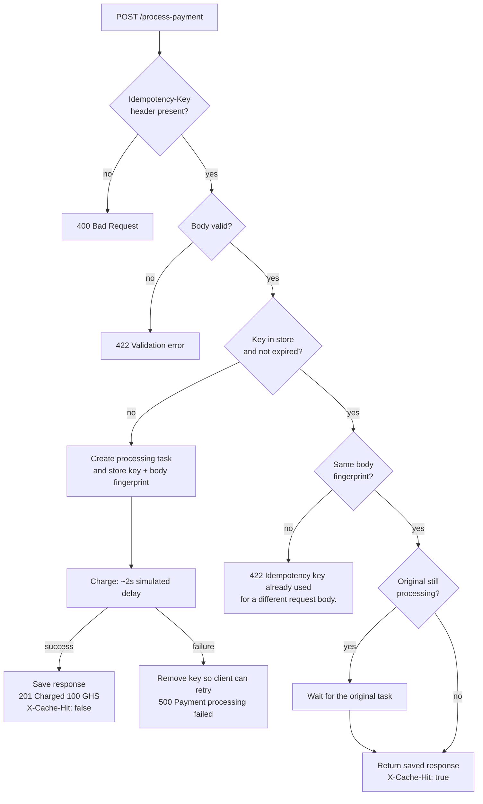
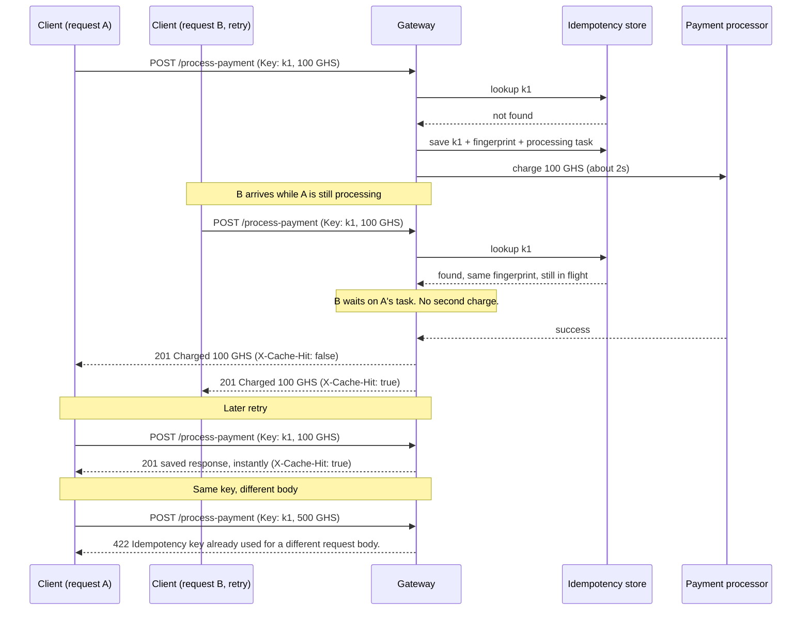

# Idempotency Gateway (the "Pay-Once" Protocol)

A small payment API for **FinSafe Transactions Ltd.** that guarantees a payment is processed **exactly once**, no matter how many times a client retries the same request. Clients send an `Idempotency-Key` header; the first request is processed and its response saved, and every duplicate gets that saved response back instantly.

Built with Python 3.11+ and FastAPI. State is held in memory.

## Contents

1. [Architecture](#1-architecture)
2. [Setup](#2-setup)
3. [API documentation](#3-api-documentation)
4. [Design decisions](#4-design-decisions)
5. [Developer's Choice: key expiry](#5-developers-choice-key-expiry-ttl)
6. [Tests](#6-tests)

---

## 1. Architecture

### Request flow



### Sequence: first request, replay, and in-flight duplicate



### Code layout

```
app/
  main.py      FastAPI app, request validation, idempotency flow, simulated processor
  store.py     In-memory idempotency store with TTL expiry
docs/
  openapi.json Exported OpenAPI (Swagger) spec
scripts/
  export_openapi.py
tests/
  test_api.py  Behaviour of the endpoint
  test_docs.py Swagger/OpenAPI output
```

---

## 2. Setup

Requires Python 3.11 or newer.

```bash
cd backend/Idempotency-gateway

python3 -m venv .venv
source .venv/bin/activate          # Windows: .venv\Scripts\activate
pip install -r requirements.txt

uvicorn app.main:app --port 8000
```

The server is now on `http://localhost:8000`. Interactive Swagger docs are at `http://localhost:8000/docs` (see [Interactive docs](#interactive-docs-swagger)).

### Configuration (optional environment variables)

| Variable                      | Default | Meaning                                                  |
| ----------------------------- | ------- | -------------------------------------------------------- |
| `PAYMENT_PROCESSING_DELAY`    | `2`     | Seconds the simulated processor takes to "charge".       |
| `IDEMPOTENCY_KEY_TTL_SECONDS` | `86400` | How long a key (and its saved response) is remembered.   |

### Try it

```bash
# First request: takes ~2 seconds
curl -i -X POST http://localhost:8000/process-payment \
  -H 'Content-Type: application/json' \
  -H 'Idempotency-Key: order-1001' \
  -d '{"amount": 100, "currency": "GHS"}'

# Same request again: instant, same body, X-Cache-Hit: true
curl -i -X POST http://localhost:8000/process-payment \
  -H 'Content-Type: application/json' \
  -H 'Idempotency-Key: order-1001' \
  -d '{"amount": 100, "currency": "GHS"}'

# Same key, different amount: 422
curl -i -X POST http://localhost:8000/process-payment \
  -H 'Content-Type: application/json' \
  -H 'Idempotency-Key: order-1001' \
  -d '{"amount": 500, "currency": "GHS"}'
```

---

## 3. API documentation

### Interactive docs (Swagger)

With the server running:

| URL                                  | What it is                                              |
| ------------------------------------ | ------------------------------------------------------- |
| `http://localhost:8000/docs`         | Swagger UI. Try requests from the browser.              |
| `http://localhost:8000/redoc`        | ReDoc, a read-only view of the same spec.               |
| `http://localhost:8000/openapi.json` | The raw OpenAPI spec.                                   |
| [`docs/openapi.json`](docs/openapi.json) | A committed copy, readable without running the server. You can paste it into [editor.swagger.io](https://editor.swagger.io). |

In Swagger UI, open **POST /process-payment**, click **Try it out**, and use **Execute** twice with the same `Idempotency-Key`. The request duration shown under each response makes the difference obvious: about 2 s the first time, a few ms on the replay, with `x-cache-hit: true`.

The spec documents every outcome (`201`, `400`, `422` for both key reuse and validation errors, `500`), the `X-Cache-Hit` response header, and examples for each.

If you change the API, regenerate the committed copy. A test fails if it is out of date:

```bash
python -m scripts.export_openapi
```

### `POST /process-payment`

**Headers**

| Header            | Required | Description                                                   |
| ----------------- | -------- | ------------------------------------------------------------- |
| `Idempotency-Key` | yes      | Unique string per logical payment. Max 255 characters.        |
| `Content-Type`    | yes      | `application/json`                                            |

**Body**

| Field      | Type    | Rules                                                   |
| ---------- | ------- | ------------------------------------------------------- |
| `amount`   | number  | Greater than 0, up to 2 decimal places, up to 12 digits |
| `currency` | string  | 3 letters (stored uppercase), e.g. `GHS`, `USD`         |

Unknown fields are rejected.

**Responses**

| Status | When                                                         | Body                                                                 | `X-Cache-Hit` |
| ------ | ------------------------------------------------------------ | -------------------------------------------------------------------- | ------------- |
| `201`  | First request for this key; payment processed                | `{"message": "Charged 100 GHS", "transaction_id": "...", "amount": "100", "currency": "GHS"}` | `false`       |
| `201`  | Duplicate (same key, same body), including one that arrived while the first was still processing | Exact copy of the first response                  | `true`        |
| `400`  | `Idempotency-Key` missing, blank or longer than 255 characters | `{"error": "Idempotency-Key header is required."}`                 | not set       |
| `422`  | Same key already used with a different body                  | `{"error": "Idempotency key already used for a different request body."}` | not set |
| `422`  | Body fails validation (negative amount, bad currency, ...)   | FastAPI validation error detail                                      | not set       |
| `500`  | The charge itself failed. The key is released so a retry is allowed | `{"error": "Payment processing failed. Retry with the same Idempotency-Key."}` | not set |

**Example: first request**

```http
POST /process-payment HTTP/1.1
Idempotency-Key: order-1001
Content-Type: application/json

{"amount": 100, "currency": "GHS"}
```

```http
HTTP/1.1 201 Created
x-cache-hit: false

{"message":"Charged 100 GHS","transaction_id":"e87f0e2e-39bc-48b8-9b4e-8fd7bafb1373","amount":"100","currency":"GHS"}
```

**Example: replay (note the identical `transaction_id`)**

```http
HTTP/1.1 201 Created
x-cache-hit: true

{"message":"Charged 100 GHS","transaction_id":"e87f0e2e-39bc-48b8-9b4e-8fd7bafb1373","amount":"100","currency":"GHS"}
```

**Example: key reuse with a different body**

```http
HTTP/1.1 422 Unprocessable Content

{"error":"Idempotency key already used for a different request body."}
```

---

## 4. Design decisions

**Store the task, not just the result.** The store maps `key -> (body fingerprint, asyncio task)`. A duplicate that arrives mid-processing finds the running task and awaits it, so it blocks, then returns the same result with `X-Cache-Hit: true`. It never starts a second charge and never gets a `409`. This is the bonus in-flight story, and it falls out of the design instead of needing a separate lock.

**The check-and-insert is atomic.** Looking up the key and registering the new task happen with no `await` in between. On a single event loop, two simultaneous requests cannot both conclude they are the first.

**Fingerprint the meaning of the body, not its bytes.** The body is parsed and validated, then hashed in a canonical form. `{"amount": 100, "currency": "GHS"}`, `{"currency": "ghs", "amount": 100.0}` and different key ordering or whitespace are the same payment, so they replay. A genuinely different amount or currency under the same key is rejected. `amount` is a `Decimal`, never a float, so money does not pick up rounding errors.

**`422` for key reuse.** The brief allows `422` or `409`. `422` was chosen to keep `409` free for the "request is still in flight" meaning that the spec explicitly says not to use.

**A client disconnect does not cancel a charge.** The processing task is `shield`ed from the request. If the original caller hangs up, the charge still completes and is saved, so waiting duplicates and later retries still get the result.

**Failures are not cached.** If the charge raises, the key is removed before the error is returned, so the client can retry with the same key. Caching a `500` would permanently block that payment.

**Validation runs before the idempotency check.** A malformed body never creates a key.

**In-memory store, single process.** This is deliberate for the exercise. The `IdempotencyStore` class is the only thing that touches state, so swapping it for Redis is a contained change (see below).

### Known limits and what production would need

- **Single instance only.** With several app instances behind a load balancer, the in-memory store is per-process and two instances could both process the same key. Production needs a shared store with an atomic "set if absent" (for example Redis `SET key value NX EX ttl`) and a way for waiters on other instances to be notified or poll for completion.
- **State is lost on restart.** A retry after a crash would be processed again. A durable store fixes this, ideally with the key recorded in the same transaction as the charge.
- **The processor is simulated.** `charge()` in `app/main.py` is where a real payment provider call goes, ideally passing the idempotency key through to the provider too.

---

## 5. Developer's Choice: key expiry (TTL)

**What:** Every idempotency key, and the response saved for it, expires after a configurable time (default 24 hours, set by `IDEMPOTENCY_KEY_TTL_SECONDS`). Expired keys are dropped lazily when looked up and also by a background sweeper that runs while the app is up. A key whose request is still being processed is never evicted.

**Why:** Without expiry the store grows forever, because every payment ever made adds an entry that is never freed. On a payment processor that is a slow memory leak that ends in an outage. A time limit also matches how real payment APIs behave (Stripe, for example, keeps keys for 24 hours). Retries from a network timeout happen within seconds or minutes, so a day is far more than enough. After that window the key is treated as new, which also stops an old key from being replayed against a stale response long after the original order is gone.

**How it is tested:** `test_keys_expire_after_ttl` and `test_purge_removes_only_expired_completed_entries` drive the store with a fake clock, so they check the exact expiry boundary without sleeping.

---

## 6. Tests

```bash
pip install -r requirements-dev.txt
pytest
```

The suite covers each acceptance criterion: first request, duplicate replay (same body, same `transaction_id`, `X-Cache-Hit: true`, no delay), key reuse with a different body, concurrent duplicates sharing one charge, a conflicting body arriving mid-processing, input validation, failed charges not being cached, and key expiry.
