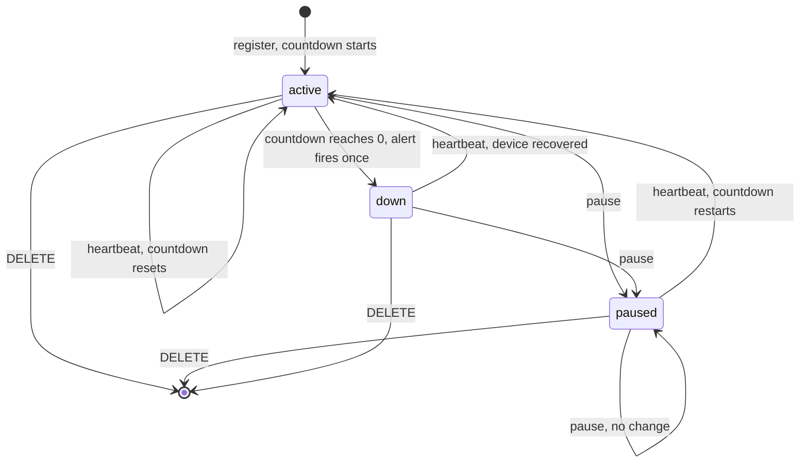
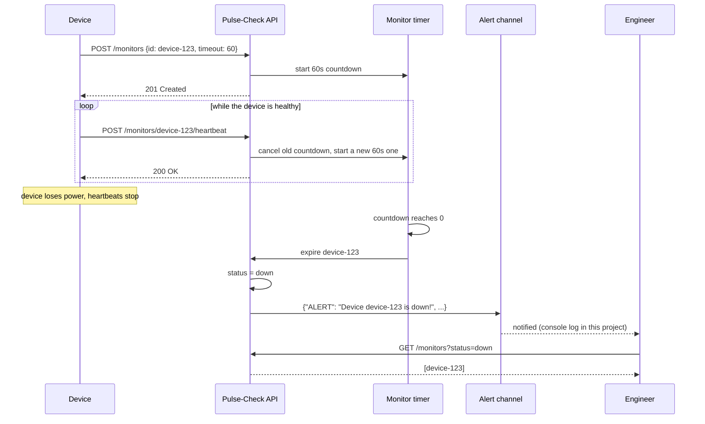
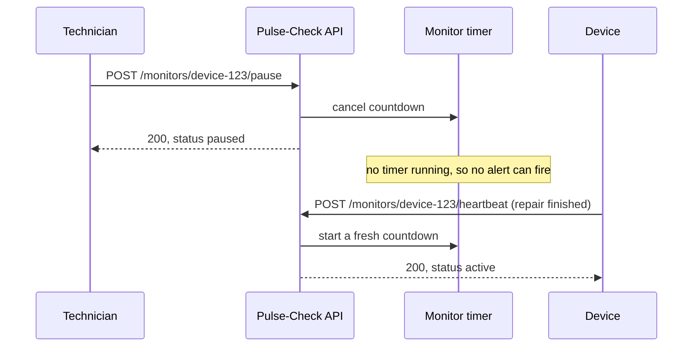

# Pulse-Check API (the "Watchdog" Sentinel)

A **dead man's switch** for **CritMon Servers Inc.**, who monitor remote solar farms and weather stations with poor connectivity. Each device registers a monitor with a countdown and sends a heartbeat now and then. As long as heartbeats keep arriving, nothing happens. If a device goes quiet and its countdown reaches zero, the system raises an alert and marks the device `down`, so CritMon hears about a dead device without anyone reading logs.

Built with Python 3.11+ and FastAPI. State is held in memory.

## Contents

1. [Architecture](#1-architecture)
2. [Setup](#2-setup)
3. [API documentation](#3-api-documentation)
4. [Design decisions](#4-design-decisions)
5. [Developer's Choice: status visibility](#5-developers-choice-status-visibility)
6. [Tests](#6-tests)

---

## 1. Architecture

### Monitor lifecycle



### Sequence: a device that stops talking



### Sequence: pausing for maintenance



### Code layout

```
app/
  monitors.py   Monitor model, the service that owns every timer, status rules
  alerts.py     Alert channel (prints a JSON line). Swap for email or webhook
  schemas.py    Request and response models
  docs.py       OpenAPI descriptions for responses
  main.py       FastAPI app and endpoints
docs/
  openapi.json  Exported OpenAPI (Swagger) spec
scripts/
  export_openapi.py
tests/
  test_monitor_service.py   Timers and rules, no HTTP
  test_api.py               Register, heartbeat, alert, pause
  test_status_api.py        Get, list, delete
  test_docs.py              Swagger/OpenAPI output
```

---

## 2. Setup

Requires Python 3.11 or newer.

```bash
cd backend/Pulse-Check

python3 -m venv .venv
source .venv/bin/activate          # Windows: .venv\Scripts\activate
pip install -r requirements.txt

uvicorn app.main:app --port 8000
```

The server is on `http://localhost:8000`. Alerts appear in this terminal.

> Run it as **one process** (no `--workers`). State lives in memory, so each worker would have its own set of monitors. See [Known limits](#known-limits).

### Try it

Register a device with a short timeout, then watch the server terminal:

```bash
curl -X POST http://localhost:8000/monitors \
  -H 'Content-Type: application/json' \
  -d '{"id": "device-123", "timeout": 10, "alert_email": "admin@critmon.com"}'

# keep it alive (repeat within 10 seconds)
curl -X POST http://localhost:8000/monitors/device-123/heartbeat

# now stop sending heartbeats. After 10 seconds the server prints:
# {"ALERT": "Device device-123 is down!", "time": "2026-...", "alert_email": "admin@critmon.com"}

curl http://localhost:8000/monitors/device-123        # status: "down"
```

---

## 3. API documentation

### Interactive docs (Swagger)

| URL                                  | What it is                                            |
| ------------------------------------ | ----------------------------------------------------- |
| `http://localhost:8000/docs`         | Swagger UI. Try every endpoint from the browser.      |
| `http://localhost:8000/redoc`        | ReDoc, a read-only view of the same spec.             |
| `http://localhost:8000/openapi.json` | The raw OpenAPI spec.                                 |
| [`docs/openapi.json`](docs/openapi.json) | A committed copy, readable without running the server. |

If you change the API, regenerate the committed copy. A test fails if it is stale:

```bash
python -m scripts.export_openapi
```

### Endpoints

| Method   | Path                              | Purpose                                | Success |
| -------- | --------------------------------- | -------------------------------------- | ------- |
| `POST`   | `/monitors`                       | Register a monitor, start its countdown | `201`   |
| `POST`   | `/monitors/{id}/heartbeat`        | Reset the countdown                    | `200`   |
| `POST`   | `/monitors/{id}/pause`            | Stop the countdown, no alerts          | `200`   |
| `GET`    | `/monitors`                       | List monitors, optional `?status=`     | `200`   |
| `GET`    | `/monitors/{id}`                  | One monitor with time remaining        | `200`   |
| `DELETE` | `/monitors/{id}`                  | Stop monitoring and forget the device  | `204`   |

Errors always use the shape `{"error": "<message>"}`, except `422` validation errors, which use FastAPI's `{"detail": [...]}`.

### `POST /monitors`

**Body**

| Field         | Type   | Rules                                                              |
| ------------- | ------ | ------------------------------------------------------------------ |
| `id`          | string | 1 to 64 characters: letters, digits, `.`, `-`, `_`                 |
| `timeout`     | number | Seconds. Greater than 0, at most 604800 (7 days). Fractions allowed. Must be a JSON number, not `"60"` |
| `alert_email` | string | A valid email address                                              |

Unknown fields are rejected.

```http
POST /monitors
Content-Type: application/json

{"id": "device-123", "timeout": 60, "alert_email": "admin@critmon.com"}
```

```http
HTTP/1.1 201 Created

{
  "message": "Monitor 'device-123' created. An alert fires if no heartbeat arrives within 60 seconds.",
  "id": "device-123",
  "status": "active"
}
```

| Status | When                                  |
| ------ | ------------------------------------- |
| `201`  | Monitor created, countdown started    |
| `409`  | A monitor with this `id` already exists |
| `422`  | Body failed validation                |

### `POST /monitors/{id}/heartbeat`

Resets the countdown to the full timeout. The message tells you what happened:

| Previous status | Message                                                              |
| --------------- | -------------------------------------------------------------------- |
| `active`        | `Heartbeat received. Timer reset to 60 seconds.`                     |
| `paused`        | `Heartbeat received. Monitor resumed, timer reset to 60 seconds.`    |
| `down`          | `Heartbeat received. Monitor recovered, timer reset to 60 seconds.`  |

| Status | When                  |
| ------ | --------------------- |
| `200`  | Countdown reset       |
| `404`  | No monitor with this id |

### `POST /monitors/{id}/pause`

```http
HTTP/1.1 200 OK

{
  "message": "Monitor 'device-123' paused. No alerts will fire until the next heartbeat.",
  "id": "device-123",
  "status": "paused"
}
```

Pausing an already paused monitor is harmless. `404` if the id is unknown.

### The alert

When a countdown reaches zero the monitor becomes `down` and one JSON line is printed to the server console:

```json
{"ALERT": "Device device-123 is down!", "time": "2026-11-23T18:40:21.635761+00:00", "alert_email": "admin@critmon.com"}
```

`time` is UTC, ISO 8601. The alert fires **once** per outage: a `down` monitor has no timer, so it stays quiet until a heartbeat revives it.

### `GET /monitors/{id}`

```json
{
  "id": "device-123",
  "status": "active",
  "timeout": 60,
  "alert_email": "admin@critmon.com",
  "seconds_remaining": 41.3,
  "created_at": "2026-01-01T08:00:00+00:00",
  "last_heartbeat_at": "2026-01-01T08:00:19+00:00",
  "last_alert_at": null
}
```

`seconds_remaining` is `null` when the monitor is `paused` or `down`. `404` if the id is unknown.

### `GET /monitors`

Returns a list of the objects above. Filter with `?status=active`, `?status=paused` or `?status=down`. An unknown status returns `422`.

### `DELETE /monitors/{id}`

`204 No Content`. The timer is cancelled and the id can be registered again. `404` if the id is unknown.

---

## 4. Design decisions

**One `call_later` timer per monitor, not a polling loop.** Each monitor schedules its own expiry on the event loop. A heartbeat cancels it and schedules a new one. There is no background thread scanning every monitor each second, so alerts fire on time rather than up to a polling interval late, and an idle system does no work.

**A heartbeat and an expiry can never interleave.** Timer callbacks and request handlers all run on the single event loop, and the code between "cancel the timer" and "start a new one" has no `await`. If a heartbeat arrives at the moment a timer is due, whichever the loop runs first wins and the other sees consistent state. No locks are needed. This is also why the handlers are `async def`: a plain `def` handler would run in a worker thread with no event loop.

**The status changes before the alert is sent.** If the alert channel breaks (an SMTP outage, for example), the monitor is still marked `down` and the error is logged. A failing notification can never leave a dead device looking healthy.

**One alert per outage.** On expiry the monitor's timer is cleared and it moves to `down`. Nothing re-arms it until a heartbeat arrives, so a dead device does not alert every `timeout` seconds.

**A heartbeat from a `down` device revives it.** The brief only specifies heartbeat behaviour for a timer that has not expired. A device that lost power and came back should not be locked out, so its heartbeat returns it to `active` and restarts the countdown. If it dies again it alerts again. The response message says `recovered` so the client can tell.

**Pause keeps the monitor but removes the timer.** A paused monitor has no countdown, so there is nothing that could fire. Any heartbeat un-pauses it, as the brief asks.

**Duplicate ids return `409`.** Silently resetting an existing monitor on re-registration could hide a mistake, such as two devices sharing an id. Delete first if you really want to replace it.

**Strict input.** `timeout` must be a real number (not `"60"` or `true`) and is capped at 7 days. A huge value cannot overflow the scheduler.

**The alert channel is a function.** `MonitorService` takes an `on_alert(monitor)` callback. The default prints JSON. An email or webhook sender is a drop-in replacement, and tests pass in a list collector.

### Known limits

- **Single process only.** With several workers or instances each has its own monitors, and a heartbeat sent to one will not reset a timer in another. Scaling out needs a shared store and a single owner for each timer (for example Redis with key expiry notifications, or a database plus a scheduler with leader election).
- **State is lost on restart.** Registered monitors and their countdowns disappear. A durable store would need to rebuild timers from saved deadlines on startup.
- **The alert channel is the console.** It matches the brief. `alert_email` is stored and included in the alert, but no email is actually sent.
- **No authentication.** Anyone who can reach the API can register, ping or delete monitors.

---

## 5. Developer's Choice: status visibility

**What:** Three endpoints that let you ask the system what it knows:

- `GET /monitors/{id}` returns the status, **seconds remaining** on the countdown, and the times of the last heartbeat and last alert.
- `GET /monitors?status=down` lists monitors, optionally filtered to the ones that have stopped talking.
- `DELETE /monitors/{id}` removes a device that has been decommissioned, and frees its id.

**Why:** The problem statement says CritMon has "no way of knowing if a device has gone offline" without a human checking logs. The brief's design pushes a notification out, but once the alert has scrolled past in a console there is no way to ask "which devices are down right now?", no way to confirm that a device is being monitored, and no way to see how close a device is to its deadline. A monitoring system you cannot query is hard to trust and hard to operate. `?status=down` turns the alert into something an engineer or a dashboard can poll, and `DELETE` stops decommissioned devices from sitting in the list or blocking their id forever.

**How it is tested:** `tests/test_status_api.py` covers every status (`active`, `paused`, `down`), the countdown decreasing between two reads, filtering, an unknown status, and that a deleted monitor never alerts and its id can be reused.

---

## 6. Tests

```bash
pip install -r requirements-dev.txt
pytest
```

56 tests cover the service rules (timers, alert-once, revive, pause, delete), every endpoint and its error responses, validation, the console alert format, and the Swagger output. The timer tests use real timers with sub-second timeouts, so the whole suite runs in under ten seconds.
